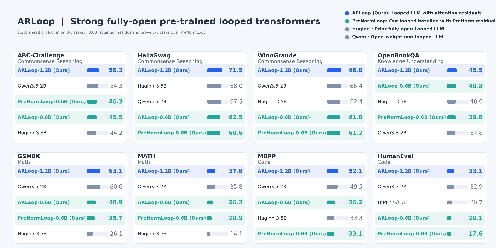

<h1 align="center">ARLoop: Fully-Open Pre-trained Looped Transformers with Attention Residuals</h1>



<div align="center" style="line-height: 1; margin-top: 16px;">
  <a href=""></a>
  <a href="https://huggingface.co/osunlp/ARLoop-0.6B"></a>
  <a href="https://huggingface.co/osunlp/ARLoop-baseline-0.6B"></a>
  <a href="https://huggingface.co/osunlp/ARLoop-1.2B"></a>
</div>

<a id="about"></a>

## 📖 About

This repository contains the official implementation of ARLoop, a fully open family of pretrained looped transformers with attention residuals.

ARLoop is pretrained using a modern, open-source LLM pretraining recipe. Our largest model, ARLoop-1.2B, outperforms [Huginn](https://huggingface.co/tomg-group-umd/huginn-0125) and achieves competitive performance against Qwen3.5-2B Base on commonsense reasoning, knowledge understanding, math, and coding tasks.

This repository provides data preparation pipelines, model implementations, training recipes, and evaluation code. The release includes controlled 140M/370M experiments on FineWeb-Edu, 180B-token pretraining runs for ARLoop-0.6B and PreNormLoop-0.6B, and a 500B-token pretraining run for ARLoop-1.2B.

<a id="how-arloop-works"></a>

## 🔄 How ARLoop works
ARLoop introduces attention residuals into looped transformers, where the input to each self-attention or FFN sublayer is calculated by selectively aggregating previous sublayer outputs through attention over model depth.

The animation below illustrates how ARLoop works. Empirically, we find that attending to the full residual history is unnecessary. Instead, sliding-window depth attention, which retains the initial embedding and recent residual states, achieves comparable or better performance than full-history attention. For more details, please refer to our [paper](https://arxiv.org/abs/2611.05234).


<a id="table-of-contents"></a>

## 📑 Table of Contents

- [📖 About](#about)
- [🔄 How ARLoop works](#how-arloop-works)
- [🔧 Installation](#installation)
- [🤗 Load a pretrained model](#load-a-pretrained-model)
- [🗂️ Prepare training data](#prepare-training-data)
- [🚀 Train](#train)
- [📊 Evaluation](#evaluation)
  - [📊 Reproducing controlled experiments](#reproducing-controlled-experiments)
  - [🧪 Reproducing realistic pretraining experiments](#reproducing-realistic-pretraining-experiments)
- [🗺️ Documentation Map](#documentation-map)
- [🙏 Acknowledgments](#acknowledgments)

<a id="installation"></a>

## 🔧 Installation

Install [uv](https://docs.astral.sh/uv/getting-started/installation/), then create
one Python 3.11 environment for data preparation, training and all evaluations:

```bash
git clone https://github.com/OSU-NLP-Group/ARLoop.git
cd ARLoop
uv venv --python 3.11
source .venv/bin/activate
uv pip install -e '.[data,evaluation,vllm]' -e third_party/flash-linear-attention
```

<a id="load-a-pretrained-model"></a>

## 🤗 Load a pretrained model

The Hugging Face release supports the standard `forward` and `generate` methods:

```python
import torch
from transformers import AutoModelForCausalLM, AutoTokenizer

model_id = "osunlp/ARLoop-1.2B"
tokenizer = AutoTokenizer.from_pretrained(model_id, trust_remote_code=True)
model = AutoModelForCausalLM.from_pretrained(
    model_id, trust_remote_code=True, dtype=torch.bfloat16,
).to("cuda").eval()

inputs = tokenizer("The capital of France is", return_tensors="pt").to("cuda")
with torch.inference_mode():
    output = model.generate(**inputs, max_new_tokens=64, do_sample=False)
print(tokenizer.decode(output[0], skip_special_tokens=True))
```

See the [model card](https://huggingface.co/osunlp/ARLoop-1.2B) for loading details
and intermediate checkpoint revisions.

<a id="prepare-training-data"></a>

## 🗂️ Prepare training data

Both tokenizers are included. For training data, follow the [data preparation guide](docs/data.md).

| Experiments | Tokenizer | Data |
|---|---|---|
| Controlled 140M/370M | `tokenizer/parcae_tokenizer/` | FineWeb-Edu |
| Mixed-data 0.6B/1.2B | `tokenizer/smollm2_tokenizer/` | Mixture sources |

For the controlled FineWeb-Edu pipeline:

```bash
python scripts/data/create_fineweb_edu.py
```

This downloads, splits, tokenizes and packs the corpus, then verifies the outputs.

For the mixed data sources used for 0.6B and 1.2B experiments:

```bash
python scripts/data/create_mix_data.py openmathinstruct2 --stage all
# List other sources and their options:
python scripts/data/create_mix_data.py --help
```

<a id="train"></a>

## 🚀 Train

Choose a recipe and pass the number of GPUs per node:

```bash
bash scripts/train/run_train.sh configs/fineweb_edu/140m_arloop_full_r2.yaml 4
bash scripts/train/run_train.sh configs/mixed_data/0p6b_arloop_r3_180b.yaml 8
bash scripts/train/run_train.sh configs/mixed_data/1p2b_arloop_r3_500b.yaml 8
```

<a id="evaluation"></a>

## 📊 Evaluation

### Reproducing controlled experiments

Run the controlled ten-task, zero-shot suite on a native checkpoint:

```bash
python scripts/evaluate/evaluate_lm_harness.py \
  --config configs/fineweb_edu/140m_arloop_full_r2.yaml \
  --checkpoint /path/to/checkpoint
```

Results go to `results/arloop_control.json`.

### Reproducing realistic pretraining experiments

Evaluation uses vLLM by default and loads the original weights directly, without
exporting another checkpoint. Run all eight benchmarks on `osunlp/ARLoop-1.2B`:

```bash
python scripts/evaluate/evaluate_all_benchmarks_vllm.py --allow-code-execution
```

Use `--model` for another HF repository or local HF directory, and `--revision`
for a specific HF checkpoint. To evaluate a native training checkpoint:

```bash
python scripts/evaluate/evaluate_all_benchmarks_vllm.py \
  --checkpoint /path/to/run/checkpoints-DDPStrategy/step-XXXXXXXX \
  --allow-code-execution
```

The training run directory is inferred from the checkpoint location, and the
tokenizer path is read from `run_config.json`. Native input must be a single
checkpoint file, not an FSDP shard directory.

This runs ARC-Challenge (25-shot), HellaSwag (10-shot), WinoGrande (5-shot),
OpenBookQA (0-shot), GSM8K (5-shot), Minerva MATH (4-shot), MBPP (0-shot)
and HumanEval (0-shot), including EvalPlus base/plus scores. Use
`--generation-only` instead of `--allow-code-execution` to save code samples
without executing them.

To evaluate an individual harness task:

```bash
python scripts/evaluate/evaluate_vllm_lm_harness.py \
  --tasks hellaswag --num-fewshot 10
```

<a id="documentation-map"></a>

## 🗺️ Documentation Map

| Topic | Documentation |
|---|---|
| Data preparation | [Data](docs/data.md) |
| Training | [Training](docs/training.md) |
| Evaluation | [Evaluation](docs/evaluation.md) |

<a id="acknowledgments"></a>

## Acknowledgments

This code builds on [Parcae](https://github.com/sandyresearch/parcae), [nanochat](https://github.com/karpathy/nanochat), [litgpt](https://github.com/lightning-ai/litgpt) and kernels from [Flash Linear Attention](https://github.com/fla-org/flash-linear-attention).

## 📝 Citation
```bibtex
@misc{yao2026arloop,
  title={{ARLoop}: Fully-Open Pre-trained Looped Transformers with Attention Residuals},
  author={Yuekun Yao and Yupei Du and Dawei Zhu and Huan Sun},
  year={2026},
  eprint={2611.05234},
  archivePrefix={arXiv},
  primaryClass={cs.CL},
  url={https://arxiv.org/abs/2611.05234}
}
```
