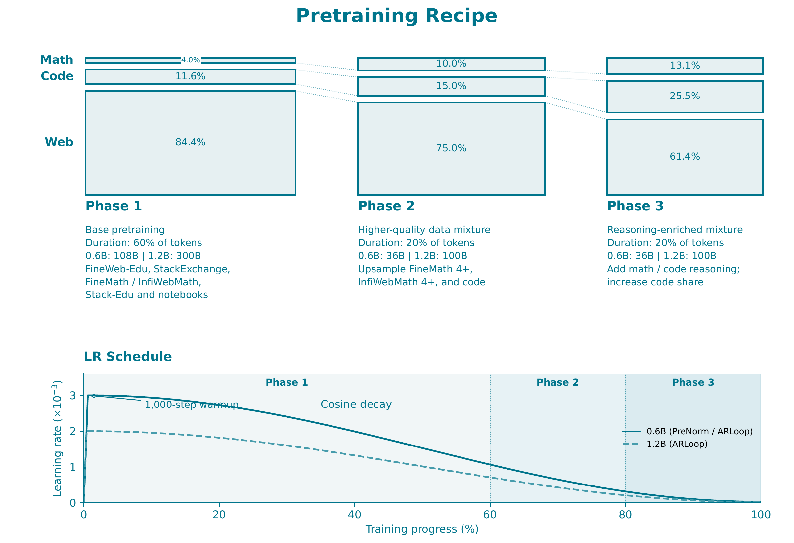

# Training

Use the YAML files under `configs/fineweb_edu/` and `configs/mixed_data/`.

## Controlled experiments
`configs/fineweb_edu/` contains training configs for the 140M/370M experiments.
The model architecture uses transformer blocks with multi-head attention and
an MLP as the feed-forward sublayer.
Following Parcae and nanochat, we use value embeddings, with each physical
layer learning distinct embeddings.
The context length is 2048. The vocabulary size is 32768.
We train on FineWeb-Edu with a cosine LR scheduler. The global batch size is 256.

To train a model, run:

```bash
bash scripts/train/run_train.sh configs/fineweb_edu/140m_arloop_full_r2.yaml 4
```

## Realistic pretraining experiments
`configs/mixed_data/` contains training configs for the ARLoop-0.6B and
ARLoop-1.2B experiments.
The model architecture uses transformer blocks with grouped-query attention
and SwiGLU as the feed-forward sublayer.
Following Parcae and nanochat, we use value embeddings shared across physical layers.
The context length is 4096. The vocabulary size is 49152.
We train on a mixture of pretraining sources with a cosine LR scheduler. The global batch size is 256 for ARLoop-0.6B and 512 for ARLoop-1.2B.

To train a model, run:

```bash
bash scripts/train/run_train.sh configs/mixed_data/0p6b_arloop_r3_180b.yaml 8
```

### Data scheduling
Training ARLoop-0.6B and ARLoop-1.2B involves three stages, each with different
sampling proportions for the data sources.
This schedule is motivated by the recipes of [SmolLM](https://huggingface.co/blog/smollm3) and [OLMo](https://arxiv.org/abs/2501.00656).
The figure below provides an overview of our data schedule.


